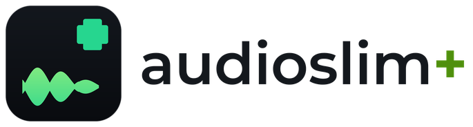
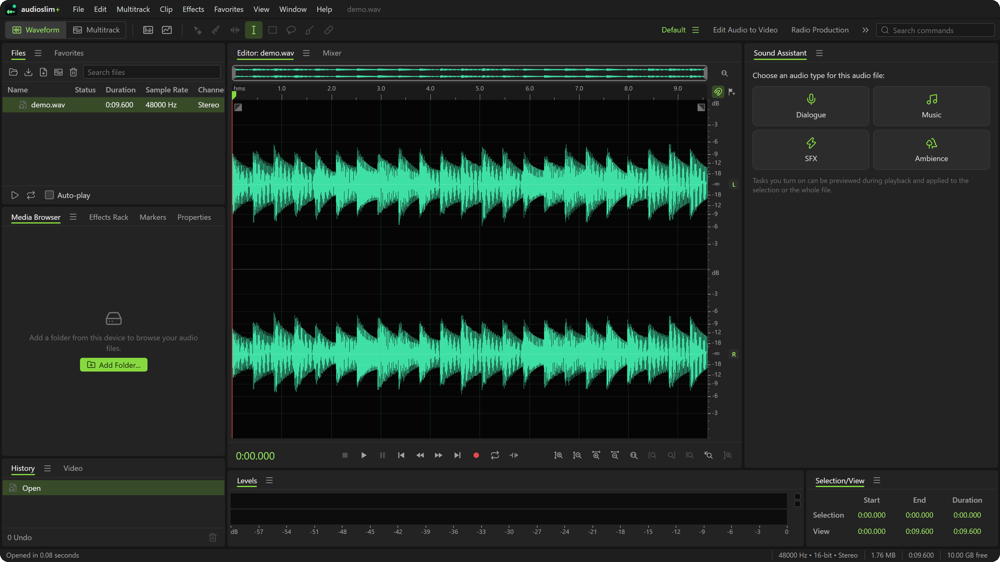
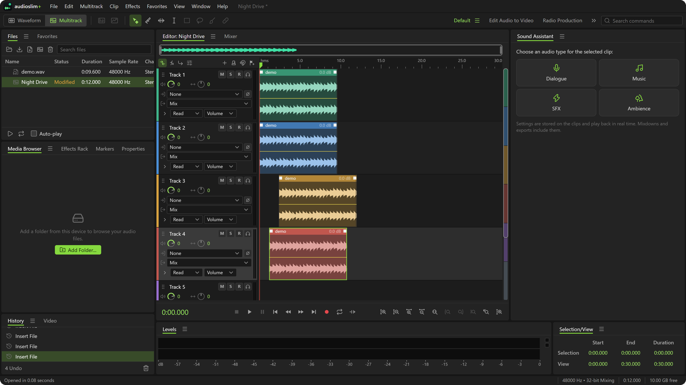

<p align="center">
  
</p>

<p align="center">
  <b>Waveform &amp; multitrack audio editor for the browser.</b><br>
  Record, edit, restore, mix and master audio — with a docked panel workspace,
  studio effects and spectral editing.<br>
  Everything runs on your own device: no account, no server, no upload.
</p>

<p align="center">
  <a href="https://salim-studio.github.io/audioslim/"><b>Live demo →</b></a>
  &nbsp;·&nbsp;
  <a href="#what-it-does">Features</a>
  &nbsp;·&nbsp;
  <a href="#development">Build it yourself</a>
</p>



## What it does

- **Waveform editor**: sample-accurate editing with five clipboards, zero-crossing adjustment, markers (cue, range, subclip, cart, CD) edited in place, spectral frequency and pitch displays with marquee, lasso, brush and healing tools, and a Preview Editor that shows an effect's result before it is applied.
- **Multitrack editor**: clips with fades, crossfades, envelopes, groups, stretching, remixing to a new length and speech alignment; buses, eight sends per track, track EQ and effect chains; automation; punch-in and loop recording into takes; mixdowns and bounces; session templates.
- **Effects**: amplitude, delay, filter and EQ, modulation, restoration (noise prints, sound models, click/pop elimination, hum, reverb and hiss removal), reverb, special and time/pitch processors, all in WebAssembly, usable live in the Effects Rack and track chains or applied to a selection, with presets and Favorites.
- **Analysis**: frequency analysis, amplitude statistics, phase meter, loudness measurement and matching, diagnostics.
- **Workspace**: docked panels (Files, Media Browser, Markers, Playlist, Mixer, Tracks, Track Panner, Time, Zoom, Transport, Tools, Events, Video...) arranged in saved workspaces; categorized Preferences; MIDI control surfaces; batch processing; JavaScript automation scripts.



The Multitrack editor: clips on tracks with fades, crossfades and envelopes,
buses and sends, per-track effect chains, automation and a full mixer.

## Working with files

| | |
| --- | --- |
| **Open** | Drag audio onto the window, use **File > Open**, or browse folders on this device from the Media Browser. |
| **Save** | **File > Save** writes back to the file you opened. **File > Export** lets you pick a format, sample type and destination. |
| **Devices** | Where the browser supports the File System Access API, saving opens a native picker and the file is written in place. Elsewhere the file is downloaded. |
| **Media Browser** | Add a folder from this device to browse it, preview files, and drag them into the editor or a session. |
| **Sessions** | A multitrack session is saved as one archive (`.zip`) holding the session file and its media. Opening it again restores the whole session. |
| **Recovery** | Unsaved work is autosaved in the browser's private storage, and offered back for restore the next time you start. |

## Architecture

| Area | Where | Notes |
| --- | --- | --- |
| Sample storage | `src/audio/channel.js` | Immutable channels made of references into shared, never-mutated `Float32Array` blocks. Cut, paste and delete only rearrange references, so undo snapshots are nearly free and long files edit without copying. |
| Documents | `src/model/` | `AudioFile` (waveform editor) with an undo `History` of immutable states; pure edit functions in `edits.js`; markers. |
| DSP | `wasm/dsp` (Rust) built to `src/audio/dsp.wasm` | FFT, spectrogram columns, peaks, statistics, resampling and the effect processors, called through a plain C ABI. The built file is committed, so the app builds without Rust. |
| Playback | `src/engine/` | One AudioWorklet mixes every track (gain, pan, envelopes, WASM effect chains). The main thread streams only the sample chunks near the playhead to the worklet. `mixcore.js` is shared with offline rendering. |
| Drawing | `src/render/` | WebGL2 waveform renderer (instanced min/max columns, sample lines when zoomed in) with a Canvas 2D fallback; peak levels cached per block. |
| UI | `src/ui/`, `src/panels/`, `src/editor/` | Command registry drives menus, shortcuts and buttons; docked panels with workspaces; responsive layouts for desktop, tablet and phone. |
| Video | `src/video/`, `src/model/session-video.js` | A session's video track: the picture of an inserted video file as a thumbnail strip above the tracks, and the Video panel, a muted `<video>` kept in step with the playhead. Mixdowns ignore it. |
| Features | `src/features.js` | Feature modules register commands, panels and document kinds. |
| Commands | `src/commands/`, `src/multitrack/commands.js` | Menu commands by area (core, edit, file, view, help, scripts). |
| Multitrack | `src/multitrack/`, `src/model/session*.js` | Session model and edits, graph building (routing, sends, EQ), recording, stretching, alignment, templates. |
| Storage | `src/storage/` | Device files and folders (File System Access API), autosave and session backups in the origin private file system, preferences in `localStorage`. |
| Hardware | `src/control-surface/` | Web MIDI control surfaces: a DAW-controller protocol and learned mappings. |
| Branding | `tools/make-brand-assets.py` | Draws the audioslim+ mark, the wordmark and every icon in `public/` and the repository root. |
| Screenshots | `tools/make-demo-audio.mjs` | Generates the demo audio the README screenshots are taken with. |

## Development

```sh
npm install
npm run dev        # http://127.0.0.1:5621/
npm test           # vitest
npm run build      # checks dependency licenses, then builds to dist/
npm run build:wasm # rebuilds src/audio/dsp.wasm (needs Rust 1.85.1 with wasm32-unknown-unknown)
```

In development, `window.as` is the app and `as.openDev(['name.wav'])` opens test files from the gitignored `.dev-media/` folder.

The brand assets are generated, not hand-drawn. After changing `tools/make-brand-assets.py`, run:

```sh
python tools/make-brand-assets.py
```

It writes the mark, the wordmark (`public/logo.png`), the icon set and the
social card. The README screenshots are taken from the running app, with the
demo audio built by:

```sh
node tools/make-demo-audio.mjs .dev-media/demo.wav
```

## Deployment

`main` is published to GitHub Pages by `.github/workflows/deploy-pages.yml`: the workflow installs with `npm ci`, builds to `dist/`, and uploads it as the Pages artifact. The Vite `base` is relative (`./`), so the build works unchanged under the repository sub-path.

The site is served at <https://salim-studio.github.io/audioslim/>. To publish a change, push to `main`; to publish manually, run the **Deploy to GitHub Pages** workflow.

## Third-party

- [Lucide](https://lucide.dev) icons (ISC), plus original glyphs in `src/ui/icons.js`.
- [lamejs](https://github.com/breezystack/lamejs) (LGPL-3.0) for MP3 encoding, loaded as a separate chunk.

## License

Copyright © 2026 salim-slimani.

This repository, including all its contents, sub-projects, modules, and components, is licensed under [MIT](./LICENSE) unless explicitly stated otherwise. Third-party libraries included in this repository may be subject to their own licenses.
